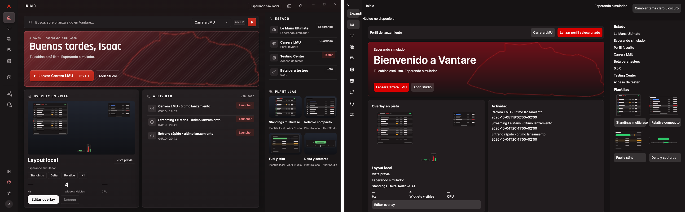
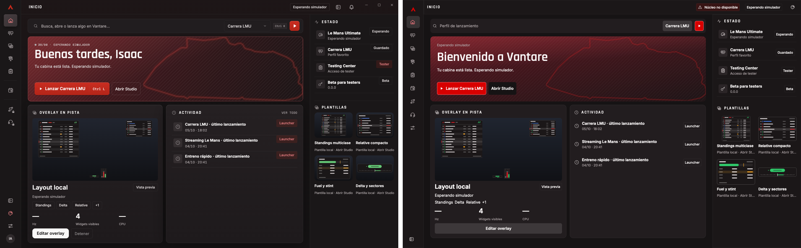
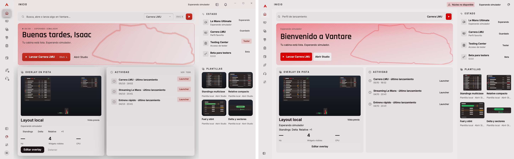
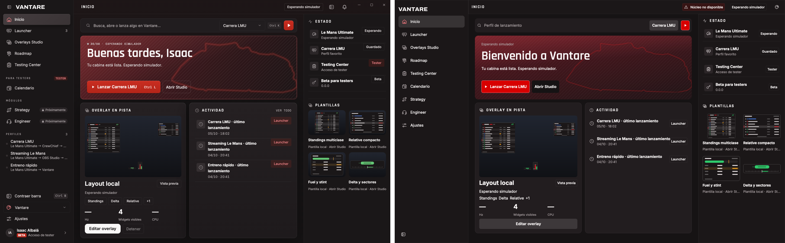
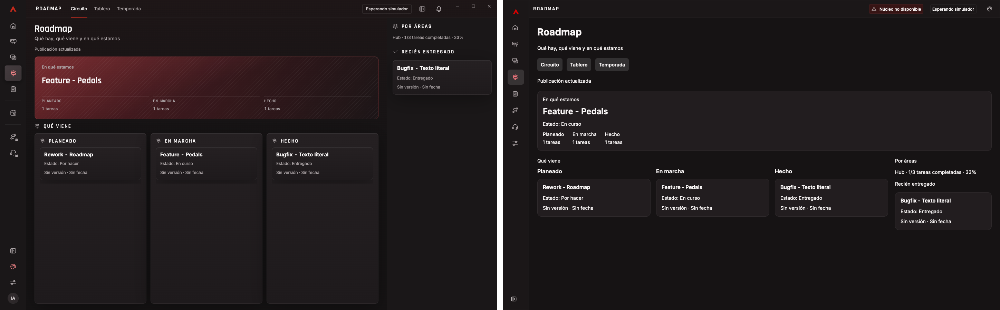
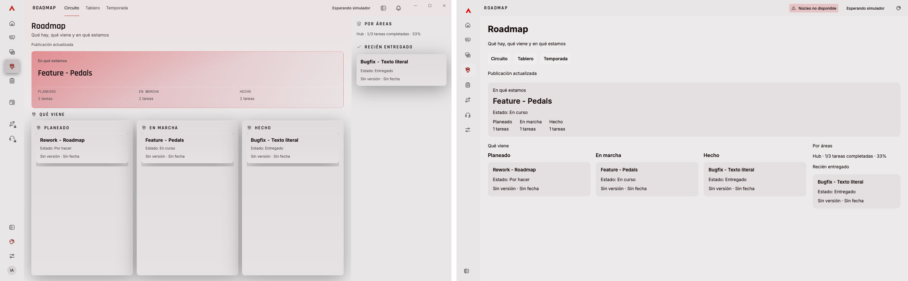

# Corte 1 · Hub Rune · VANTA-143 / #2256

**Pendiente de aceptación.** Isaac aprobó el funcionamiento manual y rechazó
el aspecto inicial. El PR prioritario [#2297](https://github.com/isaacalbala12/Vantare-Simracing-Suite/pull/2297)
corrige el marco e Inicio; la nueva aprobación visual sigue pendiente.

| Requisito ADR 0108 §4 | Resultado verificado | Pendiente para aceptar |
| --- | --- | --- |
| Windows 10 22H2 y 11, 100/125/150 % | Build, Clippy y 53 tests Windows en CI PASS; capturas Mac en las tres escalas | Ventana real en ambos Windows; windows-latest y capturas Mac no certifican esos sistemas |
| Teclado español, acentos y AltGr en campos | Catálogo y casos Unicode compartidos PASS | Entrada física/IME/AltGr en campos reales; el marco aún no incorpora formularios |
| Todo por teclado y controles con nombre | **PASS manual de Isaac en Mac:** Tab, Enter, Espacio, tema, Inicio/Roadmap y X; «súper bien». Tests de foco, activación y nombres PASS | Lector de pantalla real; el PASS manual corresponde a 5e1c7024 |
| Aspecto fiel aprobado por Isaac | **FALLO visual inicial de Isaac.** Nuevas comparativas completas y arreglos en #2297 | Revisión y aprobación visual de Isaac; las capturas no convierten el resultado en PASS |
| Media hora sin cierres ni bloqueos | Tests de protocolo, cancelación y cierre PASS | Sesión continua real de 30 minutos; no se sustituye por tiempo virtual |

## Evidencia de la corrección visual

Código capturado: `f980b5355ed82ec17a620cf7b13eeeda30cb0e5b`.
Antes y referencia Electron QA: `5e1c70241ccf57378041dc2dcceabacff2bc9447`.
[Registro verificable](evidence/fidelidad/validation.json): hashes, escalas, checks,
prueba manual, comportamiento en segundo plano y limpieza.

66 celdas por cliente: marco expandido/contraído, Roadmap publicado/vacío/error
e Inicio en seis estados, en claro/oscuro y a 100/125/150 %. Viewport lógico
1440×900; PNG físicos 1440×900, 1800×1125 y 2160×1350. 198 PNG originales y
132 comparativas antes/después. Sin estirar una referencia 100 % para fabricar otra escala.

Informe completo: `D:/VantareServer/evidence/hub-rune/corte1/index.html`.
Originales y manifiestos: `before/`, `after/`, `electron/`; comparativas:
`comparisons-before/` y `comparisons-after/`. Electron va a la izquierda y Rune
a la derecha. Estos ejemplos a 100 % permiten revisar el PR desde GitHub:

### Inicio oscuro · antes

### Inicio oscuro · después

### Inicio claro · después

### Marco expandido

### Roadmap

Se corrigieron raíl, cabecera, iconos, aviso del núcleo, tipografía/pesos,
fechas locales, estados laterales y leyendas de plantillas. Los tests comprueban
las fuentes efectivamente seleccionadas y que el aviso no desplaza Inicio ni
las leyendas invaden otras tarjetas. Saludo/nombre, paleta/atajos y avisos del
siguiente corte siguen pendientes; no se declara paridad completa.

## Ejecución y límites

Rune usa `--snap` offscreen con 181 frames virtuales y un solo PNG final.
Electron usa un entry QA accessory, ventana oculta, sin foco ni show/activación;
se verificaron visible=false, focused=false y focusable=false en las 66 celdas.
Ningún proceso QA fue la aplicación en primer plano. No se usó System Events ni
permiso de Automatización. La referencia es el renderer Electron QA real en Mac
con viewport/DPR CDP, complementario al banco HWND Windows; no es una prueba de
ventana Windows. El antiguo guion que abría ventanas se retiró de esta tanda.

El servidor solo compiló y ejecutó tests CPU, por la cola, un slot y -j2 con
targets D:. Ninguna ejecución de la aplicación ni opción gráfica de Rune en Windows.
Rune d5338988, Rust 1.99.1, --locked, 463 paquetes permisivos, sin MPL/ogg-audio.
Mac: build y 46 tests PASS; 29 avisos existentes de código del host sin uso en esa plataforma.
Los checks definitivos y HEAD de la entrega están en el PR.

La X observada por Isaac cierra la ventana; no certifica por sí sola la duración
del proceso. El cliente conserva WindowClose → CloseRequested → CloseAnswer,
plazo de 10 s, fallo de envío y recuperación de rechazos tipados. Reapertura/foco
tras un rechazo y smoke del anfitrión real Windows siguen pendientes; detalles
de E/S cancelable y cierre en [README](README.md).

## Limpieza del Mac

Retirado exclusivamente `~/target-isa-2256-hub-rune` (3,16 GiB lógicos) y 93
perfiles temporales QA. Espacio libre medido: 16,48 → 19,84 GiB. Cero procesos
propios de captura pendientes. Se conservó el binario debug y su hash en
`~/orq/isa2256-fidelidad-f980b5355/`; no se ejecuta automáticamente.
No se tocaron targets de Isaac ni de otros workers. Sin cuentas ni datos reales,
cambios de hub-host/overlays/instalador/distribución, merges, promociones o releases.
