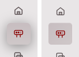
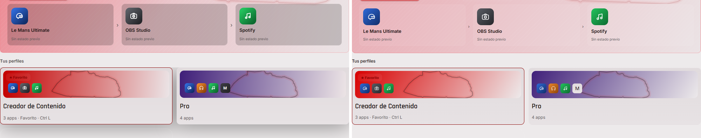
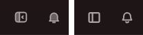
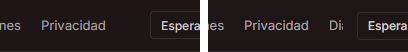
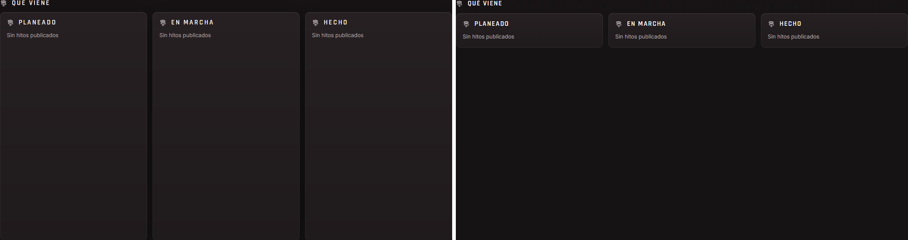
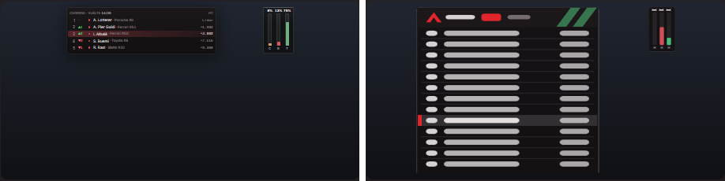
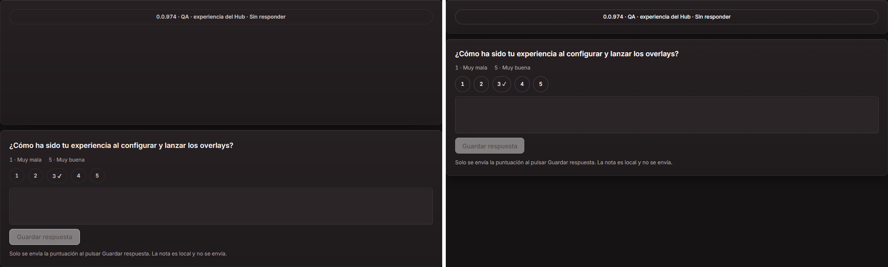
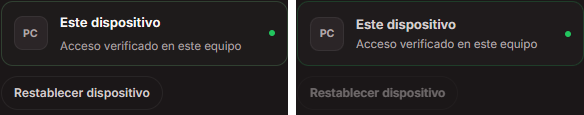

# Barrido de paridad del Hub — primera versión completa, con límites

UI congelada: nightly `9401501ea38f2e8fe65584511f27844c7efd157a`. Candidato QA aislado construido una vez; no sustituye al Hub distribuido. Capturas HWND reales, 1440×900, Vantare, 100 %, seriadas mediante cerrojo global.

Porcentaje perceptual: pixelmatch 8.0.0, umbral 0,1, antialias incluido, imagen completa sin máscaras ni alineación. Se verifica el recibo de la referencia antes de comparar. No equivale a una valoración humana. † Puerta sin barra: ambos estados usan la misma captura real, no son dos disposiciones diferentes.

Fuentes verificadas en los recibos fonts.json: Inter 400/500/600/650/700/750/800, Space Mono y Rajdhani. devicePixelRatio=1 y zoom=1. El inventario contiene 44 escenas y cuatro columnas; los PNG de diferencia representan el cambio RGBA exacto y los porcentajes de la tabla usan el criterio perceptual anterior.

| Pantalla                                      | Responsable | Oscuro contraída |         Oscuro expandida | Claro contraída |          Claro expandida |
| --------------------------------------------- | ----------- | ---------------: | -----------------------: | --------------: | -----------------------: |
| Inicio · inicio-base                          | B           |           6,34 % |                   7,24 % |          6,60 % |                   7,27 % |
| Inicio · inicio-vacio                         | B           |           3,64 % |                   4,32 % |          3,70 % |                   4,16 % |
| Inicio · inicio-cargando                      | B           |           1,26 % |                   1,94 % |          2,36 % |                   2,82 % |
| Inicio · inicio-error                         | B           |           4,88 % |                   5,62 % |          5,60 % |                   5,93 % |
| Launcher · launcher-base                      | C           |           7,30 % |                   9,70 % |         15,03 % |                  16,00 % |
| Launcher · launcher-nuevo-perfil              | C           |           2,81 % |                   3,36 % |          6,17 % |                   6,19 % |
| Launcher · launcher-aplicaciones              | C           |           4,96 % |                   5,88 % |          4,56 % |                   5,21 % |
| Roadmap · roadmap-base                        | B           |           2,25 % |                   2,95 % |          5,01 % |                   5,16 % |
| Testing Center · testing-center-resumen       | D           |           3,25 % |                   3,94 % |          5,65 % |                   5,60 % |
| Testing Center · testing-center-cuestionarios | D           |           4,58 % |                   5,11 % |          7,90 % |                   7,53 % |
| Testing Center · testing-center-comunidad     | D           |           3,72 % |                   4,40 % |          5,13 % |                   5,29 % |
| Testing Center · testing-center-triage        | D           |           3,32 % |                   3,99 % |          5,28 % |                   5,42 % |
| Testing Center · testing-center-diagnostico   | D           |           1,93 % |                   2,70 % |          1,71 % |                   2,26 % |
| Testing Center · testing-center-informe       | D           |           5,39 % |                   6,35 % |          8,73 % |                   8,76 % |
| Calendario · calendario-r6-proximas           | D           |          10,91 % |                  10,76 % |         10,07 % |                   9,86 % |
| Calendario · calendario-r6-mias               | D           |           8,54 % |                   9,15 % |          8,02 % |                   8,43 % |
| Calendario · calendario-r6-semana             | D           |           8,21 % |                   8,51 % |          8,27 % |                   8,30 % |
| Calendario · calendario-mes                   | D           |     No integrada | Sin referencia expandida |    No integrada | Sin referencia expandida |
| Calendario · calendario-eventos-contraida     | D           |           8,27 % |                   9,37 % |          7,33 % |                   8,15 % |
| Ajustes · ajustes-aplicacion                  | A           |           4,98 % |                   5,53 % |          4,41 % |                   4,88 % |
| Ajustes · ajustes-apariencia                  | A           |           3,49 % |                   4,18 % |          3,72 % |                   4,12 % |
| Ajustes · ajustes-rendimiento                 | A           |           1,85 % |                   2,64 % |          1,54 % |                   2,20 % |
| Ajustes · ajustes-atajos                      | A           |           3,99 % |                   4,66 % |          3,48 % |                   3,96 % |
| Ajustes · ajustes-actualizaciones             | A           |           2,23 % |                   2,91 % |          2,96 % |                   3,26 % |
| Ajustes · ajustes-privacidad                  | A           |           3,54 % |                   4,14 % |          2,65 % |                   3,19 % |
| Ajustes · ajustes-diagnostico                 | A           |           2,98 % |                   3,63 % |          4,50 % |                   4,57 % |
| Ajustes · ajustes-cuenta                      | A           |           3,51 % |                   5,04 % |          3,31 % |                   4,70 % |
| Cuenta · cuenta-base                          | A           |           3,43 % |                   4,09 % |          3,36 % |                   3,71 % |
| Notificaciones · notificaciones-completa      | B           |           3,36 % |                   4,15 % |          5,54 % |                   5,89 % |
| Próximamente · strategy-proximamente          | B           |           3,49 % |                   4,13 % |          6,55 % |                   6,48 % |
| Próximamente · engineer-base                  | B           |           3,53 % |                   4,11 % |          6,54 % |                   6,35 % |
| Puertas · privacidad-pendiente                | A           |         1,26 % † |                 1,26 % † |        1,08 % † |                 1,08 % † |
| Puertas · privacidad-uso                      | A           |         2,37 % † |                 2,37 % † |        1,80 % † |                 1,80 % † |
| Puertas · acceso-base                         | A           |         0,75 % † |                 0,75 % † |        0,66 % † |                 0,66 % † |
| Puertas · email-formulario                    | A           |         0,81 % † |                 0,81 % † |        0,77 % † |                 0,77 % † |
| Puertas · email-codigo                        | A           |         1,60 % † |                 1,60 % † |        1,54 % † |                 1,54 % † |
| Puertas · email-crear-contrasena              | A           |         0,92 % † |                 0,92 % † |        0,90 % † |                 0,90 % † |
| Puertas · email-consentimiento                | A           |         0,81 % † |                 0,81 % † |        0,72 % † |                 0,72 % † |
| Puertas · email-autorizando                   | A           |         0,60 % † |                 0,60 % † |        0,44 % † |                 0,44 % † |
| Puertas · email-reiniciado                    | A           |         0,93 % † |                 0,93 % † |        0,87 % † |                 0,87 % † |
| Puertas · email-ocupado                       | A           |         0,75 % † |                 0,75 % † |        0,72 % † |                 0,72 % † |
| Puertas · email-espera                        | A           |         0,83 % † |                 0,83 % † |        0,69 % † |                 0,69 % † |
| Roadmap · roadmap-tablero                     | B           |           1,61 % |                   2,38 % |          5,48 % |                   5,61 % |
| Roadmap · roadmap-temporada                   | B           |           2,04 % |                   2,73 % |          4,27 % |                   4,39 % |

## Diferencias visibles priorizadas

Recortes sin escalar: GPUI a la izquierda, Hub nuevo a la derecha; la franja blanca solo separa ambas imágenes. Fuentes, coordenadas y SHA-256 en recortes.json.

### M03 · P2 visual · marco compartido

En claro, la entrada activa del raíl pierde la sombra suave que sí aparece en GPUI.

### C01 · P2 visual · pantalla de C · Launcher

En claro, los pasos del perfil favorito quedan mucho más transparentes y las tarjetas de perfiles pierden la sombra inferior; se distinguen a simple vista.

### M01 · P2 visual · marco compartido

El botón del panel derecho usa i-panel; el GPUI usa v-side. La silueta es distinta en todas las pantallas con marco.

### M02 · P2 visual · marco compartido

Con la barra expandida, la última pestaña asoma cortada junto a las acciones; el GPUI la oculta completa. Revisar reparto de anchura y recorte de la barra superior.

### B01 · P2 visual · pantalla de B · Roadmap

Las tres columnas vacías de Circuito se compactan a unas filas; en GPUI ocupan el espacio vertical hasta el pie del contenido.

### B02 · diferencia conocida · pantalla de B · Inicio

La vista previa de overlays usa SVG estáticos y tiene una composición distinta al layout real del GPUI. Esta diferencia fue autorizada; se conserva sin disfrazarla como paridad.

### D01 · P2 visual · pantalla de D · Testing Center

La lista del cuestionario pierde la altura libre del GPUI y adelanta el formulario de respuesta aproximadamente 200 px. También cambia el texto de estado del doble QA.

### A01 · desviación deliberada · pantalla de A · Cuenta

Restablecer dispositivo queda inactivo en la escena demo del Hub nuevo. La guarda de sesión y la confirmación fueron aprobadas expresamente; no se retiran para reducir la diferencia numérica.

## Límites y diferencias de datos

- Studio se excluye por encargo. El buzón de Launcher y los módulos sin entry.tsx en el corte (Workshop y Telemetría) no están en este candidato. Las integraciones posteriores al corte requieren otro barrido; no se atribuyen al binario congelado.
- Mes no está integrada: CalendarWeekView recibe onSpan undefined y el control queda deshabilitado. Se conserva la captura de diagnóstico del intento; no se presenta Semana como si fuera Mes.
- Notificaciones: el doble actual arranca vacío. Se abrió la vista completa mediante una notificación de prueba local; la referencia GPUI contiene cinco avisos preparados. Sus porcentajes incluyen esa diferencia de datos y no sirven para atribuir todo el cambio al estilo. No se modificó la pantalla ni su mock para disimularlo.
- Cuestionarios y Comunidad tienen algunas leyendas de estado QA distintas; quedan visibles en las imágenes. Inicio usa SVG estáticos de widgets, diferencia autorizada frente al renderizado real del GPUI.
- En Calendario se conservan las referencias contraídas del worker D y las R6 expandidas originales, con sus recibos. Las nuevas referencias se guardan en references/ sin sobrescribir las originales. Las puertas no tienen disposición expandida.
- Resultados no comparables: 4. Detalle completo y errores en resultados.json/results.json; los fallos de captura no se cuentan como diferencias del producto.

- calendario-mes / dark / contraída: Error: ENOENT: no such file or directory, open 'D:\VantareServer\evidence\hub-web\barrido-paridad\captures\calendario-mes\dark\calendario-mes\sidebar-collapsed.png'
- calendario-mes / dark / expandida: missing-reference
- calendario-mes / light / contraída: Error: ENOENT: no such file or directory, open 'D:\VantareServer\evidence\hub-web\barrido-paridad\captures\calendario-mes\light\calendario-mes\sidebar-collapsed.png'
- calendario-mes / light / expandida: missing-reference

## Reproducción y evidencia

Desde hub-web: scripts/sweep-capture.ps1 -Scenes <escenas> -Output <evidencia>/captures -Binary <candidato>/vantare-hub-ui.exe; scripts/sweep-references.ps1 -Scenes <escenas> -Output <evidencia>/references; node --experimental-strip-types scripts/sweep-report.ts <evidencia> --complete. Solo Windows, cerrojo global obligatorio y ninguna compilación propia simultánea. Las herramientas toman el cerrojo y lo liberan al terminar cada escena.

Cada captura incluye instancia, ventana, fuentes, stderr y cierre del proceso; cada referencia nueva incluye bank.json/recibo de captura y recibo de la entrada para cambiar la barra. Los recortes se versionan; los originales a resolución completa permanecen en D:/VantareServer/evidence/hub-web/barrido-paridad/.
