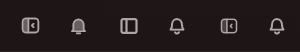
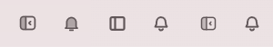
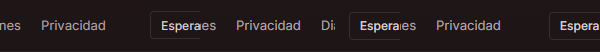
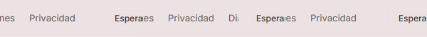
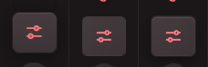
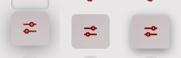

# Marco: paridad del barrido

M01: silueta v-side en el panel y en los controles compartidos del raíl. M02: pestañas parcialmente recortadas ocultas enteras; siguen en el orden del teclado, y End/Home desplazan la pestaña enfocada hasta mostrarla completa. M03: misma luz, borde y sombra del GPUI en el raíl contraído, con los tokens existentes. No cambia la API SectionChrome ni las pantallas de otros workers.

Capturas reales HWND 1440×900, Vantare, escala 1, oscuro/claro y raíl contraído/expandido, de una en una con captura.lock. Antes: producto nightly 3be885989; después: este cambio. Referencias y recibos del barrido #2114 sin modificar. Pixelmatch umbral 0,1, antialias incluido, imagen completa sin máscaras; las diferencias restantes de contenido y otras pantallas no se disimulan.

| Tema  | Raíl      | Antes % | Después % |
| ----- | --------- | ------: | --------: |
| dark  | collapsed |  4.9820 |    4.9825 |
| dark  | expanded  |  5.5330 |    5.5272 |
| light | collapsed |  4.4129 |    4.3704 |
| light | expanded  |  4.8762 |    4.8701 |

## Recortes reales: GPUI · antes · después

### M01

### M02

### M03

El chequeo del paquete prueba End → Diagnóstico → Home → Cuenta → General, recorte completo, SVG del panel y sombra activa en los cuatro estados. Recibos en after-fixed/ajustes-aplicacion/{dark,light}/ajustes-aplicacion/frame-checks.json. Un píxel libre al final del listado evita el redondeo entero de scrollWidth en Chromium; no cambia las medidas de las pestañas. ResizeObserver y el listener de scroll se retiran al desmontar.

Originales, diferencias y logs: D:\VantareServer\evidence\hub-web\marco-barrido. Reproducir con sweep-capture.ps1 y VANTARE_HUB_FRAME_ASSERT=1 para el paquete corregido; después node --experimental-strip-types scripts/frame-parity-report.ts <evidencia> <referencias-del-barrido>. No se compila GPUI, no se añaden dependencias y no se cambia el contrato ni el paquete distribuido.
