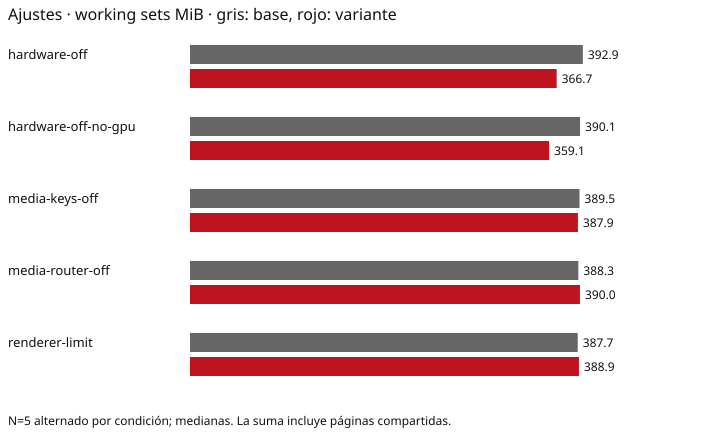

# Medición-2 · memoria y arranque del Hub Electron

**Completado: cinco experimentos aislados y una serie diagnóstica por fases, cinco pares alternados por serie (60 arranques válidos), Ajustes e Inicio. Solo QA; ningún cambio de producto aplicado.**

VANTA-138 · #1995 · 12-11-2026. Se reutiliza la UI `9401501ea38f2e8fe65584511f27844c7efd157a` de medición-1 y Electron 45.2.3, para aislar opciones sobre la misma base. Estas cifras no son una medición de nightly actual ni del paquete distribuido.

Las cinco series de opciones se tomaron antes del mantenimiento de D:, sin compilación propia; no quedó registrado el estado global de la cola en esas series. Son resultados exploratorios. La nueva serie de traza/base se toma después de reparar D:, con captura.lock reservado y compilaciones ausentes al inicio, al final y en 70 comprobaciones entre fases. Se compara cada opción con sus cinco bases de la misma tanda; no se atribuyen a una opción las diferencias entre épocas o entre tandas.

Reserva de la serie de traza: 2026-11-12T23:43:04.6691404+01:00 → 2026-11-12T23:47:10.6227460+01:00. [Registro de reserva](reservation-trace-1794523178753.json). La espera hasta disponer del servidor no forma parte del tiempo de arranque del proceso.

## Resultado principal

Desactivar aceleración reduce el working set y, sobre todo, el compromiso privado. No elimina el proceso GPU. Los otros flags no demuestran un ahorro que justifique cambiarlos por defecto. El heap JS queda por debajo de los 60 MB del diseño. Las cinco variantes de optimización no alcanzan el objetivo histórico de 250 MB de working sets.

Formato: mediana [mínimo–máximo]. Δ pareada = mediana de las cinco diferencias B−A. Cada A corresponde a su propia B: no comparar condiciones de horas distintas como si fueran simultáneas.

| Experimento aislado | Ajustes WS MiB A → B | Δ pareada MiB | Visible ms A → B | GPU A → B |
| --- | --- | --- | --- | --- |
| hardware-off | 392,86 [385,20–398,00] → 366,66 [361,31–398,73] | -26,42 [-36,69–13,53] | 941,30 [807,01–3879,72] → 990,21 [804,86–1845,43] | 1 → 1 |
| hardware-off-no-gpu | 390,07 [387,32–501,78] → 359,12 [358,07–362,48] | -31,06 [-139,29–-28,20] | 2041,24 [1137,89–2647,16] → 2398,98 [1372,58–3866,97] | 1 → 1 |
| media-keys-off | 389,50 [387,70–390,60] → 387,91 [385,71–394,87] | -1,45 [-2,30–4,87] | 894,20 [862,97–1132,12] → 841,93 [809,75–1162,22] | 1 → 1 |
| media-router-off | 388,33 [383,26–391,83] → 389,97 [388,76–415,04] | 0,43 [-1,66–26,84] | 1033,79 [837,32–8125,99] → 1139,32 [896,56–3985,64] | 1 → 1 |
| renderer-limit | 387,72 [372,97–394,30] → 388,93 [383,11–394,78] | 1,20 [-5,82–18,39] | 1316,66 [813,14–2246,76] → 1333,24 [857,58–1502,16] | 1 → 1 |
| trace | 389,52 [386,67–392,61] → 389,79 [386,58–392,73] | 0,71 [-5,84–3,12] | 1046,13 [922,10–1544,35] → 1207,44 [916,03–1667,90] | 1 → 1 |

La traza N=5 es una línea temporal de marcas explícitas del main y Paint Timing del renderer, no un perfil de CPU V8. Los pilotos de contentTracing.stopRecording no completaron el volcado en 20 s; se conservan como incompletos y no se computan. La alternativa evita depender de ese grabador y permite medir creación de ventana, carga, handshake, FCP y show con el mismo reloj de época. No permite atribuir CPU a compilación V8 ni prometer un ahorro de snapshot. El ACK de arranque QA comprueba hub-ready antes de retirar boot-pending; no se desactiva la protección del anfitrión.

## Aceleración: memoria, CPU, heap y fluidez

| Vista / condición | Working set MiB | Privada comprometida MiB | Privada residente MiB | Heap JS usado MiB | CPU % de un núcleo |
| --- | --- | --- | --- | --- | --- |
| settings / baseline | 392,86 [385,20–398,00] | 360,30 [232,61–367,93] | 159,44 [152,76–162,91] | 8,68 [7,84–8,73] | 0,00 [0,00–0,00] |
| home / baseline | 405,92 [400,37–410,28] | 378,25 [374,16–380,32] | 170,87 [167,93–173,38] | 7,98 [7,95–9,36] | 0,00 [0,00–0,00] |
| settings / variant | 366,66 [361,31–398,73] | 140,83 [137,21–142,54] | 109,18 [105,48–110,54] | 8,74 [8,70–9,54] | 0,00 [0,00–0,31] |
| home / variant | 365,84 [364,41–396,99] | 149,78 [145,31–151,54] | 117,45 [112,72–117,77] | 7,98 [7,93–8,16] | 0,00 [0,00–0,00] |

El working set sumado cuenta páginas compartidas en más de un proceso; no es memoria física única. Private Bytes es compromiso privado, no RAM residente. Las cifras se expresan en MiB (1 MiB = 1.048.576 bytes). Si los MB del diseño son decimales, 250 MB equivalen a 238,42 MiB y 60 MB a 57,22 MiB; ninguna variante de optimización cumple el objetivo de working set bajo ninguna de las dos lecturas. El proceso GPU sigue existiendo incluso con `disable-gpu` y `disable-software-rasterizer`; Chromium informa de composición por software. No se ocultan procesos de la suma. Las medianas por proceso pueden no sumar la mediana total; los totales sí se reconcilian por muestra y sin duplicar PID. Una mediana de CPU 0 en ventanas de 5 s no demuestra consumo absolutamente nulo.

| Proceso, Ajustes | WS MiB base → sin aceleración | Privada MiB base → sin aceleración |
| --- | --- | --- |
| host | 8,71 [8,67–8,77] → 8,70 [8,67–8,76] | 1,61 [1,55–1,68] → 1,61 [1,58–1,67] |
| main | 105,07 [103,84–106,20] → 105,00 [101,84–111,18] | 49,08 [47,77–50,66] → 47,91 [46,83–51,70] |
| gpu-process | 127,23 [121,67–131,09] → 80,29 [80,02–89,55] | 245,57 [116,07–249,10] → 19,66 [19,62–19,70] |
| utility | 43,25 [43,12–44,74] → 43,30 [43,19–54,61] | 11,18 [11,10–11,41] → 11,20 [11,11–11,33] |
| renderer | 107,41 [104,21–109,21] → 129,27 [127,18–134,69] | 54,45 [52,08–55,77] → 57,97 [57,93–62,32] |

Scroll: p95 de intervalos de callbacks 17,30 [16,90–75,90] → 17,60 [17,50–18,10] ms. Se comprueban tres desplazamientos reales y dos cambios del raíl tras medir reposo, a 1440×720 y prefers-reduced-motion: no-preference solo en este ejercicio. El raíl de este candidato tiene transición CSS 0s: se verifica el cambio de tamaño, no se presenta como una animación medida. Las capturas nativas confirman contenido pintado y se han inspeccionado muestras. Estos callbacks **no son FPS presentados** ni certifican fluidez percibida en este servidor remoto. No se observó una ventana negra; falta validar percepción y consumo durante animación en un PC representativo antes de proponer un valor por defecto.

## Arranque: dónde se va el tiempo

Cinco arranques base de la nueva serie, sin exportación adicional de la línea temporal, después de reparar D: y con la reserva sin compilaciones; relojes epoch del proceso y marcas explícitas. Medianas de fases no se suman para reproducir la mediana total. El FCP puede ocurrir después de hacerse visible la ventana: mostrar no implica contenido interactivo. La prueba de interacción posterior incluye automatización y no se vende como tiempo puro del producto.

| Fase | ms, mediana [rango] |
| --- | --- |
| Arranque del anfitrión → creación del proceso Electron (incluye integridad) | 400,77 [388,12–434,19] |
| Creación de Electron → primera marca del módulo principal (carga/inicialización) | 247,25 [223,03–257,45] |
| Espera de app.ready | 25,41 [23,11–28,67] |
| Handshake hello con anfitrión | 28,20 [14,86–532,98] |
| Constructor de BrowserWindow | 40,15 [36,72–47,04] |
| Inicio de carga → DOM listo | 142,13 [114,21–205,74] |
| DOM listo → evento show | 24,91 [23,09–32,48] |
| Inicio del anfitrión → primer contenido pintado (FCP) | 1055,00 [998,90–1645,90] |
| Inicio del anfitrión → HWND visible | 1046,13 [922,10–1544,35] |

El recorrido + hash cuesta 380,80 [367,92–409,39] ms (dos recorridos; primer recorrido 7,13 [6,97–10,38], verificación/hash 372,46 [360,79–399,01]). Sigue activo en las 60 ejecuciones. Este coste es una cota de trabajo presente, no ahorro disponible sin un diseño de seguridad.

La condición de traza tiene su propia serie N=5: visible 1046,13 [922,10–1544,35] → 1207,44 [916,03–1667,90] ms. Es una comparación diagnóstica, no una optimización. Con N=5 y estos rangos solapados, no se atribuye la diferencia de medianas únicamente a las marcas. Se conservan cinco líneas temporales medidas (Explicit epoch marker timeline) y las marcas completas en trace-analysis.json. Las marcas cubren el módulo principal antes de app.ready y las etapas posteriores; Paint Timing aporta FCP en el reloj epoch del renderer. **No se atribuye un total de CPU V8/compilación: el volcado nativo no se completó y estas marcas no son un perfil de CPU.**

## Bundle y heap real

El chunk principal sellado ocupa 396,79 KiB. Todos los JS sellados suman 1204,13 KiB; CSS 194,90 KiB. Son bytes reales del paquete; no estimación por npm ni sourcemaps. El análisis offline reconstruye el mismo código y recoge contribuciones renderedLength antes de minificación final: no son bytes de heap, ni tamaños comprimidos ni ahorro garantizado. El candidato es QA y conserva sus dobles/escenas en el bundle; no se extrapola a producción.

| Grupo | Contribución renderedLength KiB (estimación) |
| --- | --- |
| application | 1012,94 |
| @base-ui/react | 668,72 |
| react-dom | 524,38 |
| @tanstack/query-core | 64,32 |
| @tanstack/virtual-core | 55,96 |
| @base-ui/utils | 32,99 |
| @floating-ui/dom | 17,96 |
| react | 17,03 |
| @floating-ui/core | 15,74 |
| scheduler | 9,13 |

Ya hay rutas con carga diferida, un renderer, spellcheck desactivado, sin sourcemaps, dos locales y fuentes recortadas. Repetir estas medidas no aporta ahorro nuevo. El heap usado de Ajustes en la base es 8,68 [7,84–8,73] MiB: no explica los ~390 MiB de la familia.

## Recomendación por ahorro y riesgo

1. **Probar desactivar aceleración en una entrega QA opcional**, solo si Isaac lo aprueba. Ahorro medido de working set pareado: -26,42 [-36,69–13,53] MiB en Ajustes; compromiso privado mucho menor. Riesgo medio: el rasterizado pasa a CPU y futuros lienzos, vídeo o scroll pueden empeorar. Validar en hardware de usuario; las dos variantes de GPU no se compararon directamente entre sí, por lo que no se demuestra un ahorro incremental de añadir más flags.

2. **Investigar el coste de integridad con un diseño separado.** El trabajo medido está arriba; cualquier caché o verificación al instalar debe conservar detección de alteraciones y resolver invalidación/TOCTOU. No se cambia ni se propone saltar el hash en este encargo.

3. **Revisar importaciones de entrada y lazy-load solo donde quede código ávido**, empezando por módulos de UI compartidos. Beneficio de memoria probablemente pequeño frente a Chromium; el intervalo carga→DOM es una cota que incluye más trabajo que JS. Ahorro sin medir: no se promete una cifra.

4. **Snapshot/code cache V8: no aplicarlo todavía.** Hace falta obtener un perfil de CPU válido y demostrar un coste de compilación relevante; complejidad de build e invalidación superior a la evidencia actual. Mostrar antes puede bajar “visible” pero enseñar una ventana vacía: no mejora por sí solo la interactividad.

5. **No aplicar renderer-process-limit ni desactivación de MediaRouter/media keys como optimización por ahora.** Ya hay un renderer; las variaciones observadas son pequeñas frente al ruido y no prueban ahorro. No se consolidan utility/GPU en procesos inseguros ni se relaja aislamiento.

## Método, comprobaciones y límites

Windows 11 del mismo servidor, con orden A/B alternado dentro de cada experimento. N=5 por condición, perfiles nuevos, caché natural: no certifica frío/caliente. Una sola operación pesada propia, cerrojo global de capturas, sin compilación propia simultánea. Reposo: 3 s de asentamiento y 5 s de CPU por vista. Algunas ventanas no obtuvieron primer plano; se registra foreground y no se oculta. El ruido y los valores extremos se muestran completos.

Cada pareja usa el mismo ejecutable, ASAR instrumentado e inventario. La serie diagnóstica de traza usa una revisión del helper QA que exporta marcas temporales explícitas (creación, carga, handshake, primer pintado y ventana visible), sin grabador nativo de CPU; su base y variante usan esa misma revisión. El código UI y los datos son iguales a los otros experimentos; la generación exacta queda en cada provenance.json. Solo cambia un identificador cerrado de experimento en datos QA. Se verificaron fuses, locales, integridad ASAR/manifiesto, preferencias de aislamiento y ausencia de peticiones externas. Ninguna cuenta ni compra real. Cierre controlado con cero procesos supervivientes en cada una de las 60 ejecuciones válidas. La serie de traza sincroniza además la salida de los descendientes por handles (plazo total de 5 s), porque salir el padre no garantiza que el cierre asíncrono del Job Object ya haya concluido; el plazo y la guarda de cero supervivientes no se omiten. Las series interrumpidas por límites HWND y por descendientes detectados inmediatamente tras cerrar (ya ausentes en la comprobación posterior) o familia de procesos cambiante durante reposo, y los pilotos, están excluidos, no sustituidos por sus mejores muestras.

[Tablas completas: dispersión, CPU, procesos, fluidez y exclusiones](RESULTADOS-N5.md). Datos crudos en paired-*/samples.json y JSON por vista; estadísticas en statistics.json, fases en startup-phases.json, módulos en bundle-analysis.json y trazas por marcas en paired-trace-*/startup-trace-*.json. Procedencia y hashes del banco en cada provenance.json. El banco y tablas se respaldan en la rama de QA vantareapp/isa-1995-medicion-2; no hay PR de optimización ni cambio aplicado al producto.
